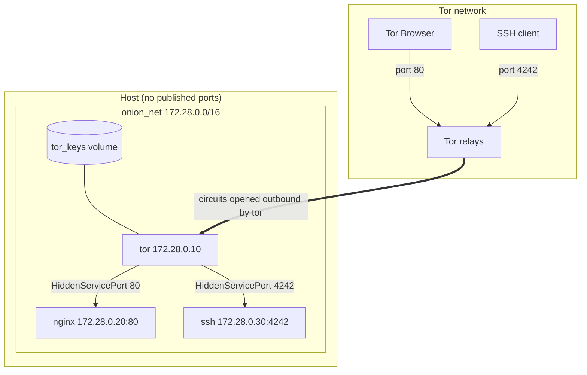
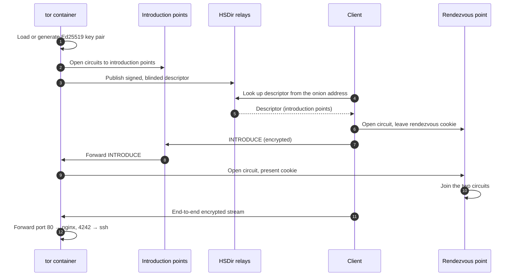
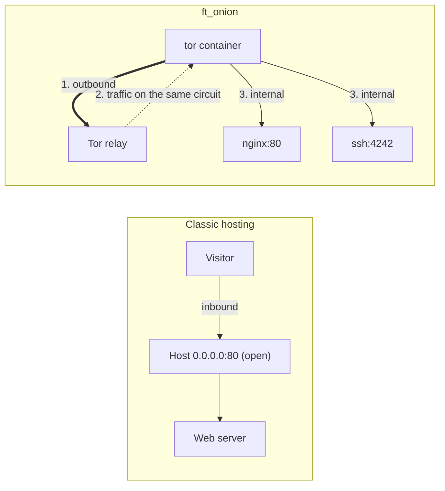

# ft_onion

A static web page and an SSH server, reachable only as a **Tor v3 onion service**, with **no ports open on the host**.
42 Cybersecurity Piscine.


> The configuration files are the reference and are never copied here.
> This README explains how it works, how to build it step by step, and why each choice was made.

---

## Table of Contents

1. [Overview](#1-overview)
2. [How It Works](#2-how-it-works)
3. [Build It Step by Step](#3-build-it-step-by-step)
4. [Usage](#4-usage)
5. [Testing](#5-testing)
6. [Evaluation Guide](#6-evaluation-guide)
7. [Troubleshooting](#7-troubleshooting)

---

## 1. Overview

### Subject requirements

| Requirement | Value |
| --- | --- |
| Web server | **Nginx only** |
| HTTP port | **80** |
| SSH port | **4242** |
| Host ports / firewall rules | **None.** No ports opened, no firewall rules |
| Required files | `index.html`, `nginx.conf`, `sshd_config`, `torrc` |
| Bonus | SSH fortification and an interactive web application |

### Files

```text
├── Makefile             build / run / connect / test shortcuts
├── docker-compose.yml   the 3 containers and their network
├── nginx/  Dockerfile  nginx.conf  index.html
├── tor/    Dockerfile  torrc
├── ssh/    Dockerfile  sshd_config  authorized_keys (generated, not committed)
└── scripts/tests.sh     automated checks
```

| File | Purpose |
| --- | --- |
| [nginx/index.html](nginx/index.html) | The page: an interactive snake game (bonus) |
| [nginx/nginx.conf](nginx/nginx.conf) | Nginx on port 80, hardened |
| [ssh/sshd_config](ssh/sshd_config) | OpenSSH on port 4242, key-only, hardened |
| [tor/torrc](tor/torrc) | The v3 onion service and its port mappings |
| [docker-compose.yml](docker-compose.yml) | Three containers on a private network, no published ports |
| [Makefile](Makefile) | Build, run, connect, test |
| [scripts/tests.sh](scripts/tests.sh) | Automated checks |

---

## 2. How It Works

### Architecture



### 2.1 Onion service connection flow

Neither side learns the other's IP address, and traffic is encrypted end to end.



### 2.2 The v3 onion address

A v3 address is the service's **Ed25519 public key**, encoded:

```text
onion_address = base32(PUBKEY | CHECKSUM | VERSION) + ".onion"
CHECKSUM      = SHA3-256(".onion checksum" | PUBKEY | VERSION)[:2]
VERSION       = 0x03
```

32 + 2 + 1 = 35 bytes = 280 bits. Base32 stores 5 bits per character, so the address is always **56 characters**. The checksum catches typos and the version byte allows future formats.

**Self-authenticating.** The client already holds the server's public key, because it is the address. No DNS, registrar or certificate authority is involved. Only the holder of the secret key can run the service (see [Step 4](#step-4-tor-and-the-onion-keys)).

| | v2 (removed in 2021) | v3 |
| --- | --- | --- |
| Length | 16 chars | 56 chars |
| Key | RSA-1024 | Ed25519 |
| Hash | SHA-1 | SHA3-256 |
| Directory privacy | HSDirs could collect addresses | Blinded keys, rotated daily, keep addresses from HSDirs |

### 2.3 Why no ports are needed

> *"You should not open any ports or set any firewall rules."*

Normal hosting waits for incoming connections, so the host has to publish a port (`-p 80:80`). An onion service only makes **outbound** connections:

1. The `tor` container opens outbound connections to Tor relays.
2. Visitor traffic comes back over those circuits. NAT and firewalls let it through because the connection started from inside.
3. `tor` forwards each stream over the internal Docker network to nginx:80 or ssh:4242.
4. Docker binds nothing on the host, so a port scan of the host finds nothing for this project.



### 2.4 Why three containers

The subject allows any tooling as long as the choices are justified.

| Container | Role | What it cannot see |
| --- | --- | --- |
| `tor` | Onion identity and routing | Web files, SSH keys |
| `nginx` | Serves `index.html` | Tor keys, SSH |
| `ssh` | Administration access | Tor keys, web server process |

- **Least privilege:** a compromised service does not get the others' processes or secrets.
- **Smaller attack surface:** each image has only the packages it needs.
- **Easier debugging:** one log stream per service.

All images use **current, supported bases** (Alpine 3.24, Debian 13 trixie) and upgrade their packages at build time to get the latest security fixes. **Nothing runs as root at runtime** except sshd's master process, which needs root to switch users at login (that is how OpenSSH is designed).

---

## 3. Build It Step by Step

Each step says what to run, what each file **must do** and **why**, and how to check it before moving on.

### Step 0: Install tools

```bash
# macOS (plus Docker Desktop)
brew install tor torsocks
brew services start tor

# Debian / Ubuntu
sudo apt install -y docker.io docker-compose-v2 tor torsocks netcat-openbsd
sudo usermod -aG docker "$USER"          # log out and back in
sudo systemctl enable --now tor
```

Check that the local Tor client listens on `127.0.0.1:9050`. It is used only to test from your machine:

```bash
nc -z 127.0.0.1 9050 && echo ok
```

Also install [Tor Browser](https://www.torproject.org/download/) to view the page.

> [!NOTE]
> SSH over Tor uses `nc -X 5` (SOCKS5). Only BSD/OpenBSD netcat supports `-X`. On macOS, do **not** `brew install netcat`: GNU netcat would shadow `/usr/bin/nc`. The [Makefile](Makefile) and [tests](scripts/tests.sh) call `/usr/bin/nc` for this reason.

### Step 1: Project layout

```bash
mkdir -p nginx tor ssh scripts
```

Create [.gitignore](.gitignore) **first**, so keys can never be committed. It must cover `ssh/authorized_keys`, `ssh/id_*` and `hidden_service/`.

### Step 2: Web page and nginx

| File | Must do |
| --- | --- |
| [nginx/index.html](nginx/index.html) | One self-contained page. No external CSS, JS or fonts: everything inline. |
| [nginx/nginx.conf](nginx/nginx.conf) | Listen on port 80 and serve `/var/www/html`, plus the hardening below. |
| [nginx/Dockerfile](nginx/Dockerfile) | Alpine + `nginx`, copy both files in, run `nginx -g 'daemon off;'` in the foreground. |

**Why** each hardening setting:

| Setting | Why |
| --- | --- |
| `server_tokens off` | Hides the version, so attackers can't look up known bugs for it |
| `X-Frame-Options`, `X-Content-Type-Options` | Block clickjacking and MIME sniffing |
| `Content-Security-Policy` | Same-origin content only. Any third-party request could deanonymise a visitor |
| `location ~ /\.` → `deny all` | Dotfiles (`.git`, `.env`) can never be served |
| Logs to stdout/stderr | Visible with `docker compose logs` |

**Interactive page (bonus).** Everything is inline, so there are no CDN or web-font requests; these would leak visitors and are blocked by the CSP anyway. A `<noscript>` fallback covers Tor Browser's "Safest" level, which disables JavaScript.

**Check** without opening any host port:

```bash
docker build -t nginx_test nginx
docker run -d --name nginx_test nginx_test
docker exec nginx_test wget -qO- http://127.0.0.1     # prints your HTML
docker rm -f nginx_test
```

Use `127.0.0.1`, not `localhost`. Busybox `wget` tries IPv6 `::1` first, and nginx only listens on IPv4.

### Step 3: SSH keys and server

**Where the keys come from:**

| Key | Created by | Lives in | Committed? |
| --- | --- | --- | --- |
| **Your login key pair** | you, on the host (below) or `make keys` | `~/.ssh/ft_onion_key` (private) + `.pub` | never |
| **`authorized_keys`** | copy of your `.pub` | `ssh/authorized_keys` → baked into the image | no (`.gitignore`) |
| **Server host key** | `ssh-keygen` inside [ssh/Dockerfile](ssh/Dockerfile) at build time | `/etc/ssh/ssh_host_ed25519_key` in the image | never |

Generate your login key and hand its **public** half to the build:

```bash
ssh-keygen -t ed25519 -N "" -C "ft_onion" -f ~/.ssh/ft_onion_key
cp ~/.ssh/ft_onion_key.pub ssh/authorized_keys
```

`make keys` does the same and skips the first command if the key already exists. Never copy the private key (`ft_onion_key`, without `.pub`) into the project.

| File | Must do |
| --- | --- |
| [ssh/sshd_config](ssh/sshd_config) | `Port 4242`, key-only login for user `onion`, plus the fortification below. |
| [ssh/Dockerfile](ssh/Dockerfile) | Install `openssh-server`, create user `onion`, install `authorized_keys`, generate an Ed25519-only host key, run `sshd -D -e`. |

Two traps the Dockerfile avoids:

- **Locked account:** `useradd` leaves the account locked, and sshd refuses locked accounts *even with a valid key*. `usermod -p '*'` means "no usable password, not locked".
- **`StrictModes`:** sshd ignores `authorized_keys` unless `~/.ssh` is `700` and the file is `600`, both owned by `onion`.

**SSH fortification (bonus):**

| Measure | Settings |
| --- | --- |
| Keys only, no passwords | `PasswordAuthentication no`, `KbdInteractiveAuthentication no` |
| No root, one user | `PermitRootLogin no`, `AllowUsers onion` |
| Brute-force limits | `MaxAuthTries`, `LoginGraceTime`, `MaxSessions` |
| No pivoting | `DisableForwarding`, `PermitTunnel no` |
| Dead-session cleanup | `ClientAliveInterval`, `ClientAliveCountMax` |
| Modern crypto | Post-quantum hybrid key exchange (ML-KEM, sntrup761) plus curve25519, AEAD ciphers, Ed25519 host key only |
| Full logging | `LogLevel VERBOSE` records which key logged in |

**Check** (after step 5) the settings sshd really uses:

```bash
docker compose exec ssh sshd -T | grep -E '^(port|permitrootlogin|passwordauthentication) '
```

### Step 4: Tor and the onion keys

| File | Must do |
| --- | --- |
| [tor/torrc](tor/torrc) | One v3 hidden service: `HiddenServicePort 80` → nginx IP, `HiddenServicePort 4242` → ssh IP. |
| [tor/Dockerfile](tor/Dockerfile) | Install `tor`, create the hidden-service folder owned by `debian-tor` with mode `700`, run as `debian-tor`. |

**Why:**

- **`SocksPort 0`:** this Tor only hosts, so its client proxy is turned off: one less listening port.
- **v3 only:** v2 no longer exists on the network.
- **IP addresses in `HiddenServicePort`:** Tor needs an IP there, not a container name. That is why the containers get fixed IPs in step 5.
- **Folder `0700`, owned by `debian-tor`:** Tor refuses to start if anyone else can read the folder holding the private key.

**Where the onion keys come from:** you do **not** create them. On first start, Tor generates them in `HiddenServiceDir`:

```text
/var/lib/tor/hidden_service/
├── hs_ed25519_secret_key   private key: whoever has it owns the address
├── hs_ed25519_public_key
└── hostname                the .onion address (derived from the public key)
```

- **Read the address:** `docker compose exec -T tor cat /var/lib/tor/hidden_service/hostname`
- **Keep the same address:** the folder is stored in the `tor_keys` named volume, so it survives rebuilds and `make down`.
- **Get a new address:** delete the volume (`make fclean` or `docker compose down -v`). Tor generates fresh keys on the next start.

### Step 5: Wire it together

[docker-compose.yml](docker-compose.yml) must:

| Requirement | Why |
| --- | --- |
| Three services (`tor`, `nginx`, `ssh`), each built from its folder | [Separation](#24-why-three-containers) |
| **No `ports:` key anywhere** | Nothing is published on the host. This is the subject's rule |
| One private bridge network with **fixed IPs** matching [tor/torrc](tor/torrc) | `HiddenServicePort` needs IPs; fixed IPs keep the mapping deterministic |
| `tor_keys` named volume on Tor's hidden-service folder | Same `.onion` address across rebuilds |
| `restart: unless-stopped` | Services come back after a crash or reboot |

### Step 6: Run

```bash
make            # keys if needed, build, start, print the .onion address
make test       # automated checks
```

Open the printed address in Tor Browser, then go through [Testing](#5-testing).

---

## 4. Usage

```bash
make            # generate key if needed, build, start, print the .onion address
make ssh        # SSH into the server over Tor (needs local Tor on 127.0.0.1:9050)
make test       # run scripts/tests.sh
make logs       # follow logs
make down       # stop (keeps the .onion address)
make fclean     # stop + delete keys volume and images (new address next time)
make re         # fclean + all
```

| Variable | Default | Meaning |
| --- | --- | --- |
| `KEY` | `~/.ssh/ft_onion_key` | SSH key pair; created by `make` if missing |
| `SOCKS` | `127.0.0.1:9050` | Local Tor SOCKS proxy (Tor Browser: `127.0.0.1:9150`) |

Example: `make ssh SOCKS=127.0.0.1:9150`.

---

## 5. Testing

`make test` runs the automated checks in [scripts/tests.sh](scripts/tests.sh). The manual versions below are for the defense.

```bash
ONION=$(docker compose exec -T tor cat /var/lib/tor/hidden_service/hostname)
PROXY='ProxyCommand=/usr/bin/nc -X 5 -x 127.0.0.1:9050 %h %p'
```

Use `exec -T` when capturing output. Without it, a trailing `\r` breaks `curl` and `ssh`.

### 5.1 Web

- **Tor Browser:** open `http://<address>.onion`.
- **curl:** `curl --socks5-hostname 127.0.0.1:9050 -I "http://$ONION"`
  Expect `200 OK` and `Server: nginx` with **no version number**.

### 5.2 SSH

```bash
ssh -o "$PROXY" -i ~/.ssh/ft_onion_key -p 4242 onion@"$ONION"      # or: make ssh
```

Alternative: `torsocks ssh -i ~/.ssh/ft_onion_key -p 4242 onion@"$ONION"`.

### 5.3 No host ports are open

> [!CAUTION]
> A published port fails the project.

```bash
docker compose ps                                      # PORTS column: no "->"
docker inspect ft_onion_tor ft_onion_nginx ft_onion_ssh \
    --format '{{.Name}}: {{json .NetworkSettings.Ports}}'   # all null: not bound to the host
netstat -anv -p tcp | grep LISTEN | grep -E '\.(80|4242) '   # macOS: nothing
ss -tlnp | grep -E ':(80|4242)\b'                             # Linux: nothing
```

### 5.4 SSH hardening

Both attempts must end with `Permission denied (publickey)`:

```bash
ssh -o "$PROXY" -o PreferredAuthentications=password -p 4242 onion@"$ONION"   # password
ssh -o "$PROXY" -i ~/.ssh/ft_onion_key -p 4242 root@"$ONION"                   # root
docker compose exec ssh sshd -T          # the settings sshd actually uses
```

---

## 6. Evaluation Guide

### 6.1 Demo order

1. **Files:** `ls -l nginx/index.html nginx/nginx.conf ssh/sshd_config tor/torrc`
2. **Clean build:** `make re`. With the evaluator's own key: `make re KEY=~/.ssh/eval_key`, then `make ssh KEY=~/.ssh/eval_key`.
3. **No open ports:** [5.3](#53-no-host-ports-are-open)
4. **Web:** open the address in Tor Browser and play the game (bonus).
5. **SSH:** `make ssh`
6. **Hardening (bonus):** [5.4](#54-ssh-hardening)
7. **Persistence:** `docker compose restart tor`; the address stays the same.

### 6.2 Likely questions

**Why can people reach the service if no port is open?**
The Tor container only makes outbound connections to relays. Clients reach it through a rendezvous point that both sides connect out to, so nothing has to listen on the host.

**How is the address found without DNS?**
The address encodes the service's Ed25519 public key. Tor publishes a signed descriptor listing its introduction points to the HSDir relays. The client derives the lookup key from the address, fetches the descriptor, and connects through an introduction point.

**Why three containers?** See [2.4](#24-why-three-containers).

**Why static IPs in `torrc`?**
`HiddenServicePort` needs an IP address. Fixed IPs on a dedicated network make the mapping deterministic.

### 6.3 Common mistakes

| Mistake | Result | Prevention here |
| --- | --- | --- |
| `ports: - "80:80"` in Compose | Subject violation | No `ports:` key |
| `HiddenServiceDir` not `0700` | Tor exits on start | `chmod 700` + `chown debian-tor` in the Dockerfile |
| SSH user created but locked | Key login refused | `usermod -p '*'` in the Dockerfile |
| External fonts/CDNs in `index.html` | Blocked, possible leak | Everything inlined; strict CSP |
| Private keys committed | Security failure | `.gitignore`; keys generated locally |
| No volume for `hidden_service` | New address on every rebuild | `tor_keys` named volume |

---

## 7. Troubleshooting

| Symptom | Likely cause | Fix |
| --- | --- | --- |
| Tor exits with a permissions error | `HiddenServiceDir` not `0700` / wrong owner | Check `tor/Dockerfile`; recreate the volume (`docker compose down -v`) |
| `hostname` file missing | Tor still starting | `docker compose logs -f tor`, wait for `Bootstrapped 100%` |
| Tor Browser: "Unable to connect" | Descriptor not published yet, or nginx down | Wait 1–2 min; `docker compose exec nginx nginx -t` |
| `nc: invalid option -- X` | GNU netcat in `PATH` | Use `/usr/bin/nc` (the Makefile already does) |
| `ProxyCommand` fails or hangs | No local Tor on `9050` | `brew services start tor` or `sudo systemctl start tor` |
| `Permission denied (publickey)` with the right key | Wrong `.pub` copied, or `.ssh` permissions | `make re`; check `700`/`600` on `~onion/.ssh` |
| `curl`/`ssh` fail with a valid-looking address | `\r` captured from `docker compose exec` | Use `exec -T` |
| `wget localhost` refused inside nginx | `localhost` resolved to IPv6 `::1` | Use `127.0.0.1` |

```bash
docker compose logs -f                        # all logs
docker compose logs tor | grep Bootstrapped   # Tor progress
docker compose exec ssh sshd -T               # effective sshd config
docker compose exec nginx nginx -t            # nginx syntax check
```
